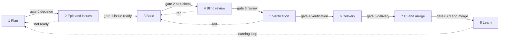

# The Micelio software factory

The factory is the one path by which a plan becomes code on `main`, with a gate between every two stages. It runs the [engineering standard](engineering-standard.md); it does not replace it. Where this document and the standard disagree, the standard wins (section 1) and this document is fixed in the same pull request. An exception to the standard is an ADR, never a line here (section 16).

It exists for three reasons: nobody may skip a stage, the agent that writes a change is never the one that reviews or verifies it, and every correction the maintainer makes once becomes a check, a skill or a rule so it is not needed again.

## The pipeline

Eight stages, seven gates between them, and one loop back from the last stage to the first. A stage hands over to the next only when its gate passes.

| Stage              | Who                    | Leaves through                     |
| ------------------ | ---------------------- | ---------------------------------- |
| 1. Plan            | Planner and maintainer | Gate 0, decision                   |
| 2. Epic and issues | Planner                | Gate 1, issue ready                |
| 3. Build           | Worker                 | Gate 2, self-check                 |
| 4. Blind review    | Reviewer               | Gate 3, blind review               |
| 5. Verification    | Verifier               | Gate 4, verification               |
| 6. Delivery        | Maintainer and worker  | Gate 5, delivery                   |
| 7. CI and merge    | CI and maintainer      | Gate 6, CI and merge               |
| 8. Learn           | Master and planner     | The learning loop, back to stage 1 |

- A red from the reviewer or the verifier sends the work back to the worker with the findings. After three rounds, the fourth red goes to the maintainer instead.
- An issue that fails gate 1 goes back to the planner. It is never handed to a worker half ready.

## Roles

Five roles and the maintainer. Each role is a prompt in `template/.claude/agents/`, which a repository receives with the template: [planner](../template/.claude/agents/planner.md), [master](../template/.claude/agents/master.md), [worker](../template/.claude/agents/worker.md), [reviewer](../template/.claude/agents/reviewer.md) and [verifier](../template/.claude/agents/verifier.md). The master starts the worker, the reviewer and the verifier, each as a new agent.

| Role       | Who                                                                       | Reads                                                                                                                                              | Produces                                                                                                                                    | Cannot                                                                                  |
| ---------- | ------------------------------------------------------------------------- | -------------------------------------------------------------------------------------------------------------------------------------------------- | ------------------------------------------------------------------------------------------------------------------------------------------- | --------------------------------------------------------------------------------------- |
| Planner    | An agent, with the maintainer in the chat                                 | The project's notes, the ADRs, the real state of the repositories, the open milestones                                                             | A scope document, then an ADR when the decision is expensive, then the epic and its issues from the templates                               | Write code; plan from memory without reading the repositories                           |
| Master     | A Herdr agent, one per milestone                                          | The epic, the organisation project, the issues                                                                                                     | Gate 1, one worker per ready issue, the reviewer and the verifier after it, the correction log, a report to the maintainer                  | Merge, push, change the substance of an issue, fix or start an issue that failed gate 1 |
| Worker     | A Herdr agent, one per issue, in its own worktree                         | `AGENTS.md`, the skill of the task, the issue, the ADRs of the area, the standard                                                                  | The branch, its tests, TSDoc and documents, the acceptance criteria proven on the repository's Docker, the pull request draft with evidence | Touch anything outside the issue's scope, weaken a check, commit with a sign-off, push  |
| Reviewer   | A new agent, with no context from the worker                              | The diff, the issue, the standard, `AGENTS.md`, the skill of the task, the ADRs of the area, the draft's "Instructions that were wrong or missing" | Findings, Blocking, Important or Suggestion, each with `path:line` and a concrete fix                                                       | Edit code; read the worker's session                                                    |
| Verifier   | A new agent with a shell, with no context from the worker or the reviewer | The pull request draft, the branch, the issue's acceptance criteria, `AGENTS.md`                                                                   | The repository's Docker re-created from scratch, every declared command run again with its numbers compared, each criterion tried           | Accept a number it did not produce; edit code; read the reviewer's findings             |
| Maintainer | The human                                                                 | What the review level of gate 5 says                                                                                                               | The Docker test of what an operator or editor sees, the `git commit -s`, the approval, the merge, the release                               | Delegate the `Signed-off-by`; merge past a red gate                                     |

The reviewer and the verifier exist because an agent that has just written something is biased in its favour. They are two agents, not one with two steps: the one that compares numbers must not have read the findings.

## The gates

A gate is a list evaluated by a machine or by an agent other than the author; gate 2 is the author's self-check, confirmed by the master. If one line fails, the work does not pass.

### Gate 0 · Decision

**When:** before the epic is created.

**Evaluated by:** the planner, with the maintainer.

**Passes when:** the decision is not expensive to undo (standard, section 12), or its ADR exists, `Proposed` or `Accepted`, and the epic cites it.

**Fails when:** the decision is expensive to undo and has no ADR, or the epic does not cite it. No ADR, no epic.

### Gate 1 · Issue ready

**When:** before a worker is started.

**Evaluated by:** the master, with `lint-issue` (#36) on the issue as `gh issue view` returns it, and the `issue-ready` workflow (#40) once they exist; by hand against this list until then.

**Passes when:** the title has a conventional prefix, with `!` when it breaks a contract; the five parts of the task template (section 12) are present and not empty; every acceptance criterion names a command, a test or a file; the issue names at least one path and one ADR or document; it has an "Out of scope" line; it has the fixed criterion "Verified by the maintainer on Docker", or on the run the repository's `AGENTS.md` names instead (see [Docker](#docker)), and a Delivery section; every issue it "Depends on" is closed.

**Fails when:** any of those lines is missing. The master moves the issue back to Backlog, leaves the report as a comment and does not add the `ready` label. It never fixes the issue itself.

### Gate 2 · Worker self-check

**When:** before the work goes to the reviewer.

**Evaluated by:** the worker, and the master checks the draft before it starts gate 3.

**Passes when:** `npm run check` is green in the worktree; every change of behaviour has a new test; user-facing strings are in `en` and `es`; new and changed exports have TSDoc; the documents the change made false are updated on the same branch; the acceptance criteria are proven on the repository's Docker; the pull request draft has Problem, What changes, For review, Tests with the real output of every command, a section "Instructions that were wrong or missing", and what could not be verified.

**Fails when:** a check is red, a line of the Done list of section 11 is unmet, the draft lacks one of those sections, or it states a result without its output.

### Gate 3 · Blind review

**When:** after gate 2.

**Evaluated by:** the reviewer, a new agent that starts with no context from the worker. Nothing is committed before gate 5, so it reads the worktree against `origin/main`, untracked files included.

**Passes when:** there are zero Blocking findings, and every Important one is fixed or justified in the pull request description. The reviewer checks in the order of section 11: correctness and edge cases; contracts and the version bump; security and permissions; tests that would fail without the change; documents the change made false; scope. It also checks that every instruction the draft says was wrong or missing is corrected on the branch (section 13).

**Fails when:** a Blocking finding remains, an Important one is neither fixed nor justified, or a wrong instruction the draft names is not corrected.

### Gate 4 · Verification

**When:** after gate 3.

**Evaluated by:** the verifier, a new agent that starts with no context from the worker and has not read the reviewer's findings.

**Passes when:** on the repository's Docker re-created from scratch from a clean copy of the worktree (nothing is committed before gate 5), every command of the draft's Tests section gives the numbers the draft reports; every acceptance criterion is shown to hold; everything the draft says was not verified has been tried, and the outcome is written down.

**Fails when:** a number differs from the reported one (always Blocking: the worker reported something that did not happen), a criterion does not hold, or a command cannot be run as written.

### Gate 5 · Delivery

**When:** after gate 4. This gate exists already: the `ship-pr` skill, which moves here with #37.

**Evaluated by:** the maintainer.

**Passes when:** the maintainer has done the review level below; has tested on Docker whatever an operator or an editor sees; has confirmed the `git commit -s` commands the worker gave; and the worker has pushed and opened the pull request only after that confirmation. The approval carries a line `time: <minutes>m diff|report`.

**Fails when:** the maintainer finds a problem (it goes back to the worker and into the correction log), or the work was committed without the maintainer's sign-off or pushed without the confirmation.

### Gate 6 · CI and merge

**When:** on the open pull request. This gate exists already (sections 11 and 15).

**Evaluated by:** CI, then the maintainer.

**Passes when:** the required checks and the DCO are green, the maintainer has approved, and the issue's Progress section is updated.

**Fails when:** a required check is red (never merged around), a commit lacks its `Signed-off-by`, or Progress is not updated. No bot merges.

## The maintainer's review levels

The reviewer's and the verifier's reports decide how the maintainer reads a pull request:

1. **Diff.** A pull request that touches a contract of section 6, security or permissions, a migration, or carries a `!`: the maintainer reads the diff.
2. **Reports.** Every other pull request: the maintainer reads the reviewer's and the verifier's reports and the description.
3. **Calibration.** One pull request in five of the second level is read whole, diff included, to check that the reports can be trusted.

These levels do not relax section 11 of the standard, which asks the human who answers for an agent-written pull request to have read the whole diff. Until the standard changes (#45) or an ADR records an exception (section 16), the maintainer still reads the whole diff before approving; the levels set what is read first and what the approval line records.

## Docker

- **The worker** proves its acceptance criteria on the repository's Docker before gate 2.
- **The verifier** re-creates that Docker from scratch from the branch and runs `npm run check` and the suites again there, at gate 4.
- **The maintainer** tests on Docker only what an operator or an editor sees: the admin UI, variables, migrations, Compose. The rest is covered by the worker's and the verifier's runs and by the integration test on Docker when a milestone closes.
- A repository without a Docker image names in its `AGENTS.md` the run that stands in for it.

## The learning loop

The factory only gets faster if every correction made once stops being needed. Principle 1 and section 13 of the standard already say so; here it is a stage with an owner.

- **Correction log.** Every time the maintainer or the reviewer sends work back, the master adds one line to `docs/factory-log.md` in `micelio-engineering` (from #38): date, issue, what was corrected, category (lint, test, skill, standard, badly written issue) and destination.
- **Retro per milestone.** When a milestone closes, the planner reads the log and, for each correction seen twice, proposes a check (an ESLint rule in `@micelio/eslint-config`, a contract test, a line in `lint-issue`), a new or corrected skill, or a line in the standard. Each proposal is a `chore(factory)` or `docs(standard)` issue. The retro ends when every line of the log has a destination and a date.
- **A procedure done twice** becomes a skill in the same milestone, with the commands that were run.
- **Instructions stay true.** A worker that finds `AGENTS.md` or a skill wrong corrects it in its pull request (section 13), and the reviewer checks it did. A wrong standard is reported to the master, who opens a `docs(standard)` issue in `micelio-engineering` (section 16): outside that repository the standard is a synced copy.
- **Nothing lives only in a chat.** What the planner and the maintainer decide goes into an ADR or a document of the repository before the epic is created. A worker never depends on a conversation it was not part of.

## Knowledge

Every kind of learning has one destination, and the destination decides who reads it and when: rules load in every session, procedures and explanations are read on demand. This keeps the files of section 1 under their word limit and stops prompts from growing with patches.

| What was learned                                  | Destination                                                                                                      | Written by                                   | When                               |
| ------------------------------------------------- | ---------------------------------------------------------------------------------------------------------------- | -------------------------------------------- | ---------------------------------- |
| A rule that must always hold                      | A check (`@micelio/eslint-config`, `lint-issue`, a contract test); the standard only when it cannot be automated | A `chore(factory)` issue from the retro      | At the second correction           |
| A convention of one repository                    | That repository's `AGENTS.md`                                                                                    | The worker who found it, in its pull request | In the same issue                  |
| A procedure that was repeated                     | A skill in `.claude/skills/`, with the commands that were run                                                    | The worker, in the same milestone            | At the second run                  |
| A decision that is expensive to undo              | An ADR, or a new ADR that supersedes one                                                                         | The planner, with the maintainer             | Before the epic                    |
| How a subsystem works                             | `docs/architecture/`                                                                                             | The worker who built it                      | In the pull request that builds it |
| A correction by the maintainer or the reviewer    | `docs/factory-log.md`, one line                                                                                  | The master                                   | At once                            |
| A plan, a scope, a half-formed idea, a retro note | The maintainer's notes outside the repositories, then an ADR, a document or the epic                             | The planner, with the maintainer             | Before the issues are created      |
| An answer given twice in Discussions              | `docs/`, in the folder of the reader who asked (section 12)                                                      | Whoever answered                             | When the discussion closes         |

- **The pull request asks for the learning.** Its description has a section "Instructions that were wrong or missing": what in `AGENTS.md`, the skill or the issue failed the worker. "Nothing" is a valid answer; a missing section is not.
- **Expiry.** A skill no worker used in two milestones, and a document of `docs/architecture/` untouched for two release lines, come up in the retro to be deleted or rewritten. Old knowledge costs: agents read it and believe it.
- Markdown in the repositories is plain GitHub Flavored Markdown: no wikilinks or editor-specific properties.

## Metrics

Taken from GitHub by a script in this repository (#38) that the master runs when an issue closes. Without them nobody knows whether the process improves or only produces faster.

| Metric                                                      | Source                                  | Tells                                      |
| ----------------------------------------------------------- | --------------------------------------- | ------------------------------------------ |
| Issues sent back at gate 1                                  | The comments of `lint-issue`            | The quality of planning                    |
| Worker and reviewer rounds per issue                        | The master's comments                   | The quality of the work and of the issue   |
| Blocking findings per pull request, by category             | The reviewer's report                   | What should become a check                 |
| Verifier discrepancies                                      | The verifier's report                   | Whether workers report real evidence       |
| Maintainer corrections per pull request                     | The maintainer's comments               | What the agents do not see yet             |
| Changed lines per pull request                              | GitHub                                  | The 400-line limit of section 11           |
| Red CI checks after the pull request opens                  | GitHub Actions                          | Whether gate 2 works                       |
| Defects after merge, per release line                       | `fix` issues that cite the pull request | The one measure of real quality            |
| Maintainer minutes per pull request, diff or report         | The `time:` line of the approval        | Whether the bottleneck really shrinks      |
| Learnings turned into a check, skill or rule, per milestone | The destination column of the log       | Whether the factory learns or only records |

The pilot's target: under two maintainer corrections per pull request, and zero verifier discrepancies over the last five issues of the milestone.

## Where each piece lives

Everything shared lives in this repository; each repository imports it and adds only its own.

| Piece                                                                                    | Path in `micelio-engineering`                                 | Issue    |
| ---------------------------------------------------------------------------------------- | ------------------------------------------------------------- | -------- |
| The process                                                                              | `docs/factory.md` (this document)                             | #35      |
| The role prompts                                                                         | `template/.claude/agents/`                                    | #35      |
| The Herdr master prompt, and the `blind-review` and `verify-pr` skills for gates 3 and 4 | `.claude/skills/` and the Herdr prompt                        | #39      |
| The pull request template's learning section, `ship-pr` for gate 5, syncing the prompts  | `.github/pull_request_template.md`, `.claude/skills/ship-pr/` | #37      |
| Gate 1                                                                                   | `lint-issue`, then the `issue-ready` workflow                 | #36, #40 |
| The correction log and the metrics                                                       | `docs/factory-log.md` and a metrics script                    | #38      |
| The retro                                                                                | The `factory-retro` skill                                     | #41      |

The factory follows the standard itself: every script has tests, every skill is written like the others, and a change to the factory is a `chore(factory)` issue in this repository.
