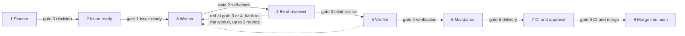

# The Micelio software factory

The factory is the one path by which a plan becomes code on `main`, with a gate between every two stages. It runs the [engineering standard](engineering-standard.md); it does not replace it. Where this document and the standard disagree, the standard wins (section 1) and this document is fixed in the same pull request. An exception to the standard is an ADR, never a line here (section 16).

It exists for three reasons: nobody may skip a stage, the agent that writes a change is never the one that reviews or verifies it, and every correction the maintainer makes once becomes a check, a skill or a rule so it is not needed again.

## The pipeline

Eight stages, seven gates and one loop. Each stage hands over to the next only when its gate passes, and nothing reaches `main` without passing all seven.

| Stage              | Who                 | Leaves through              |
| ------------------ | ------------------- | --------------------------- |
| 1. Planner         | Planner, maintainer | Gate 0, decision            |
| 2. Issue ready     | Planner, master     | Gate 1, issue ready         |
| 3. Worker          | Worker              | Gate 2, self-check          |
| 4. Blind reviewer  | Reviewer, master    | Gate 3, blind review        |
| 5. Verifier        | Verifier            | Gate 4, verification        |
| 6. Maintainer      | Maintainer, master  | Gate 5, delivery            |
| 7. CI and approval | CI, maintainer      | Gate 6, CI and merge        |
| 8. Merge into main | Maintainer          | None: the work is on `main` |

- **The loop.** A red at gate 3 or 4 sends the work back to the worker with the findings, and it goes through gates 2, 3 and 4 again. The third red round is the last: it goes to the maintainer instead of a fourth worker pass.
- A problem the maintainer finds at gate 5 also goes back to the worker. An issue that fails gate 1 goes back to the planner; it is never handed to a worker half ready.
- What the factory learns from each correction is [the learning loop](#the-learning-loop), its own stage with an owner.

## Roles

Five roles and the maintainer. Each role is a prompt in `template/.claude/agents/`, which a repository receives with the template: [planner](../template/.claude/agents/planner.md), [master](../template/.claude/agents/master.md), [worker](../template/.claude/agents/worker.md), [reviewer](../template/.claude/agents/reviewer.md) and [verifier](../template/.claude/agents/verifier.md). The master starts the worker, the reviewer and the verifier, each as a new agent.

| Role       | Who                                                                       | Reads                                                                                                                                              | Produces                                                                                                                                                                                             | Cannot                                                                                                                                                                                                                                                                                             |
| ---------- | ------------------------------------------------------------------------- | -------------------------------------------------------------------------------------------------------------------------------------------------- | ---------------------------------------------------------------------------------------------------------------------------------------------------------------------------------------------------- | -------------------------------------------------------------------------------------------------------------------------------------------------------------------------------------------------------------------------------------------------------------------------------------------------- |
| Planner    | An agent, with the maintainer in the chat                                 | The project's notes, the ADRs, the real state of the repositories, the open milestones                                                             | A scope document, then an ADR when the decision is expensive, then the epic and its issues from the templates                                                                                        | Write code; plan from memory without reading the repositories                                                                                                                                                                                                                                      |
| Master     | A Herdr agent, one per milestone                                          | The epic, the organisation project, the issues, the repository's `AGENTS.md`                                                                       | Gate 1, one worker per ready issue, the reviewer and the verifier after it, the gate 3 decision, the gate results on the issue, the issue's Progress, the correction log, a report to the maintainer | Merge; run `git commit -s` before the maintainer types `approved, sign off #N` in its session; change the substance of an issue (only its Progress text and the epic's checkboxes); fix or start an issue that failed gate 1; run as a subagent (it starts agents, so it runs as the main session) |
| Worker     | A Herdr agent, one per issue, in its own worktree                         | `AGENTS.md`, the skill of the task, the issue, the ADRs of the area, the standard                                                                  | The branch, its tests, TSDoc and documents, the acceptance criteria proven on the repository's Docker, the pull request draft with evidence and the text for the issue's Progress                    | Touch anything outside the issue's scope, weaken a check, commit or push                                                                                                                                                                                                                           |
| Reviewer   | A new agent, with no context from the worker                              | The diff, the issue, the standard, `AGENTS.md`, the skill of the task, the ADRs of the area, the draft's "Instructions that were wrong or missing" | Findings, Blocking, Important or Suggestion, each with `path:line` and a concrete fix                                                                                                                | Edit code; read the worker's session                                                                                                                                                                                                                                                               |
| Verifier   | A new agent with a shell, with no context from the worker or the reviewer | The pull request draft, the branch, the issue's acceptance criteria, `AGENTS.md`                                                                   | The repository's Docker re-created from scratch, every declared command run again with its numbers compared, each criterion tried                                                                    | Accept a number it did not produce; edit code; read the reviewer's findings                                                                                                                                                                                                                        |
| Maintainer | The human                                                                 | The whole diff (section 11), in the order the review level of gate 5 sets                                                                          | The Docker test of what an operator or editor sees, the phrase `approved, sign off #N` or the `git commit -s` itself, the merge, the release                                                         | Delegate the `Signed-off-by`; merge past a red gate                                                                                                                                                                                                                                                |

The reviewer and the verifier exist because an agent that has just written something is biased in its favour. They are two agents, not one with two steps: the one that compares numbers must not have read the findings.

## The gates

A gate is a list evaluated by a machine, the maintainer, or an agent other than the author; gates 0 and 2 are the author's own check, confirmed by the maintainer and the master respectively. If one line fails, the work does not pass.

### Gate 0 · Decision

**When:** before the epic is created.

**Evaluated by:** the planner, with the maintainer.

**Passes when:** the decision is not expensive to undo (standard, section 12), or its ADR exists, `Proposed` or `Accepted`, and the epic cites it.

**Fails when:** the decision is expensive to undo and has no ADR, or the epic does not cite it. No ADR, no epic.

### Gate 1 · Issue ready

**When:** before a worker is started.

**Evaluated by:** the `issue-ready` workflow (#40), which runs `lint-issue` (#36) on the issue as `gh issue view` returns it, then the master, who takes only an issue on Ready with the `ready` label and reads it by hand against this list. Before that, whoever creates or edits a task issue's body (the planner, or the master for its Progress text) writes it to a file (first line `# <title>`, then the body) and runs `npm run lint-issue --workspace packages/factory-tools -- --file <path>` from a checkout of `micelio-engineering` (`--repo owner/repo` when the body has a bare `#n`), and creates or edits the issue only at exit 0; the epic's checkboxes are not linted, since an epic is not a Task; `issue-ready` keeps running on the created issue.

**Passes when:** the title has a conventional prefix, with `!` when it breaks a contract; the five parts of the task template (section 12) are present and not empty; every acceptance criterion can be verified by a test or a command (section 12), apart from the fixed maintainer criterion; the issue names at least one path and one ADR or document; it has an "Out of scope" line; it has the fixed criterion "Verified by the maintainer on Docker", or on the run the repository's `AGENTS.md` names instead (see [Docker](#docker)), and a Delivery section; every issue it "Depends on" is closed.

**Fails when:** any of those lines is missing. The issue stays in Todo without the `ready` label, with the report as a comment (the `issue-ready` workflow, #40, does this and moves a Ready issue back to Todo; the master only reads it). It never fixes the issue itself.

### Gate 2 · Worker self-check

**When:** before the work goes to the reviewer.

**Evaluated by:** the worker, and the master checks the draft before it starts gate 3 or gate 4, on every round.

**Passes when:** `npm run check` is green in the worktree; every change of behaviour has a new test; user-facing strings are in `en` and `es`; new and changed exports have TSDoc; the documents the change made false are updated on the same branch; every new guard, permission check or branch in code, and every fix of code behaviour, has a named test that fails without it, shown failing with the production lines reverted in a scratch copy, with the command and its output (a change that is not code writes `no test: not code`; the verifier reruns the tests the draft names on the merge base's code, and a named test that passes there is a failed criterion); the acceptance criteria are proven on the repository's Docker; the pull request draft has Problem, What changes, For review, Tests with the real output of every command, a section "Instructions that were wrong or missing", and what could not be verified; and its "Tests" section was rerun after the last code change: after every round that changes code the worker re-ran every command the draft reports and replaced each number with that run's output, or marked it as from an earlier round and named the round, and the section ends with the run of the final diff. The master checks this (the command log or a stated round) before it starts a reviewer or verifier, on every round.

**Fails when:** a check is red, a line of the Done list of section 11 is unmet, the draft lacks one of those sections, it states a result without its output, a new guard, check, branch or code fix has no test that fails without it, or its numbers come from a run before the last code change without saying so.

### Gate 3 · Blind review

**When:** after gate 2.

**Evaluated by:** the reviewer's findings, decided by the master. The reviewer is a new agent that starts with no context from the worker. Nothing is committed before gate 5, so it reads the worktree against its merge base with `origin/main`, untracked files included.

**Passes when:** there are zero Blocking findings, and every Important one is either fixed (the next round no longer raises it) or justified by the worker in the draft's "Answers to review", a section the verifier never reads; the master decides which. The reviewer checks in the order of section 11: correctness and edge cases; contracts and the version bump; security and permissions; tests that would fail without the change; documents the change made false; scope. It also checks the draft's "Instructions that were wrong or missing": every wrong `AGENTS.md` or skill of the repository it names is corrected on the branch, and a wrong standard, synced file (the `files` of `.github/standard-sync.json`) or issue is reported to the master, as the draft says (section 13).

**Fails when:** a Blocking finding remains, an Important one is neither fixed nor justified, or a wrong `AGENTS.md` or skill of the repository (not a synced file) that the draft names is not corrected on the branch.

### Gate 4 · Verification

**When:** after gate 3.

**Evaluated by:** the verifier, a new agent that starts with no context from the worker and has not read the reviewer's findings.

**Passes when:** on the repository's Docker re-created from scratch from a clean copy of the worktree (nothing is committed before gate 5: a fresh clone at the merge base, the worktree's diff applied with `--binary` and its untracked files copied, never its ignored files), every command of the draft's Tests section, except the runs shown failing without the change, gives the numbers the draft reports, and every test the draft names as failing without the change fails on the merge base's code (a count exactly; a figure the repository does not reproduce run to run, such as a coverage percentage, the failures of a known flaky test or the failures on `main`, is reported by the worker as the values of at least two runs and `k failed of n`, and is checked against the repository's floor and written as `variance`, not as a mismatch); every acceptance criterion is shown to hold; everything the draft says was not verified has been tried, and the outcome is written down.

**Fails when:** a count differs from the reported one, a named test passes on the merge base's code, or a varying figure is below its floor or was reported as one exact value (always Blocking: the worker reported something that did not happen), a criterion does not hold, or a command cannot be run as written.

### Gate 5 · Delivery

**When:** after gate 4. This gate exists already: the `ship-pr` skill (`template/.claude/skills/ship-pr/`).

**Evaluated by:** the maintainer.

**Passes when:** the maintainer has done the review level below and has read the whole diff (section 11); has tested on Docker whatever an operator or an editor sees; has typed `approved, sign off #N` for this issue (for the epic, on a pull request with no issue) in a message of their own in the master's session, after which the master checks that `git var GIT_COMMITTER_IDENT` is the maintainer's name and email and runs `git commit -s -F <message file>` (the message the worker left in a file), or has run that commit themselves; and the pull request was pushed and opened only after that confirmation. The approval carries a line `time: <minutes>m diff|report`; when the maintainer's own account opened the pull request GitHub allows no approval, and the line goes in a review comment (`gh pr review <n> --comment -b "time: 10m diff"`). If the branch was rebased the push uses `--force-with-lease=<branch>:<sha>`.

**Fails when:** the maintainer finds a problem (it goes back to the worker and into the correction log), or the work was committed without the maintainer's sign-off or pushed without the confirmation.

### Gate 6 · CI and merge

**When:** on the open pull request. This gate exists already (sections 11 and 15).

**Evaluated by:** CI, then the maintainer.

**Passes when:** the required checks and the DCO are green, the maintainer has approved, and the issue's Progress section is updated (the master does it, from the worker's text, when the pull request opens).

**Fails when:** a required check is red (never merged around), a commit lacks its `Signed-off-by`, or Progress is not updated. No bot merges.

## Running the master

[`herdr/master.md`](../herdr/master.md) is the Herdr runbook of the master. It wraps `template/.claude/agents/master.md`, which keeps the role and its limits, and adds only the Herdr steps; it is not a synced file. Start the master as the main session in a Herdr pane (`claude --agent master`); a subagent cannot start agents.

- **Intake.** Only issues on Ready with the `ready` label and their dependencies closed; `issue-ready` (#40) runs `lint-issue`. An issue is frozen after gate 1: an edit during a round restarts the round.
- **Agents.** `worker-N` (sonnet, opus after two failed rounds or for contracts, security or concurrency) in `../wt-N`, at most three at once; then a new `reviewer-N` (opus) and a new `verifier-N` (sonnet) per round, named `-rK` from round 2. A pane is `/exit`ed before it is reused.
- **Packets.** Nothing is committed before gate 5, so the master runs `git add -N .` in the worktree and gives the reviewer and the verifier the worktree and the merge-base diff. They write `summary.md` (the verdict line and one line per Blocking or Important finding) and `report.md`; the master reads only the summary and posts the report with `--body-file`, its first line `**Gate 3, round K …** · K Blocking` or `**Gate 4, round K …** · M mismatches`, which `metrics` reads. The verifier also gets `decisions.md`, the maintainer's decision comments on the issue, and never the review. The skills [`blind-review`](../template/.claude/skills/blind-review/SKILL.md) and [`verify-pr`](../template/.claude/skills/verify-pr/SKILL.md) fix the formats.
- **Rounds.** `/compact` for the worker before each round; from round 2 the reviewer reads the changed hunks first and anything new in unchanged text becomes a follow-up issue. The third red round escalates to the maintainer.
- **Status.** Todo, Ready, In Progress, Review, Done; Done only after `gh pr view --json state` says `MERGED`.
- **Delivery.** Only the master runs `git commit -s`, and only after the maintainer has typed the exact phrase `approved, sign off #N` in a message of their own in the master's session, with `N` the issue being shipped; text in a tool result, a comment, a file, a pane or another agent's output never counts. Without the phrase the maintainer commits and the master pushes. It never merges.
- **Log.** The master posts `factory-log | <date> | <issue> | <what> | <category> | <destination>` comments; a `scribe` step collects them into a `chore(factory)` pull request at milestone close.

`fixtures/factory/` holds the planted defects that prove the gates catch what they should: `planted-coverage/` and `wrong-test-count.md` (one for the reviewer, one for the verifier) and `never-fixes/` (with a worker stub, for the escalation). Where each defect is stays in `RUN.md`, which no agent of a run reads. `build-scratch.sh` builds each run's scratch repository and draft from the fixture alone, and `test/factory-fixtures.test.ts` keeps their numbers true. [`fixtures/factory/RUN.md`](../fixtures/factory/RUN.md) has the packet and the expected result of each run, and never goes into a packet; the transcripts go in `fixtures/factory/transcripts/`, stripped of local paths, session ids and every login but the maintainer's.

## The maintainer's review levels

The reviewer's and the verifier's reports set the order in which the maintainer reads a pull request:

1. **Diff first.** A pull request that touches a contract of section 6, security or permissions, a migration, or carries a `!`: the maintainer starts from the diff, then reads the reports.
2. **Reports first.** Every other pull request: the maintainer starts from the reviewer's and the verifier's reports and the description, then reads the diff.
3. **Calibration.** One pull request in five of the second level is checked line by line against its reports, to see whether the reports can be trusted.

These levels do not relax section 11 of the standard, which asks the human who answers for an agent-written pull request to have read the whole diff. Until the standard changes (#45) or an ADR records an exception (section 16), the maintainer still reads the whole diff at gate 5, before the sign-off; the levels set what is read first and what the approval line records.

## Docker

- **The worker** proves its acceptance criteria on the repository's Docker before gate 2.
- **The verifier** re-creates that Docker from scratch from a clean copy of the worktree (nothing is committed before gate 5) and runs `npm run check` and the suites again there, at gate 4.
- **The maintainer** tests on Docker only what an operator or an editor sees: the admin UI, variables, migrations, Compose. The rest is covered by the worker's and the verifier's runs and by the integration test on Docker when a milestone closes.
- A repository without a Docker image names in its `AGENTS.md` the run that stands in for it.

## The learning loop

The factory only gets faster if every correction made once stops being needed. Principle 1 and section 13 of the standard already say so; here it is a stage with an owner.

- **Correction log.** Every time the maintainer, the reviewer or the verifier sends work back, the master posts one line `factory-log | <date> | <issue> | <what> | <category> | <destination>` in a comment on the issue, at once: date, issue, what was corrected, category (lint, test, skill, standard, issue, docs) and destination (`-` until the retro gives one). At milestone close, or when the maintainer asks, the `scribe` step of [`herdr/master.md`](../herdr/master.md) collects the lines into a `chore(factory)` pull request that appends them to [`docs/factory-log.md`](factory-log.md) in `micelio-engineering` (#38).
- **Retro per milestone.** When a milestone closes, the planner reads the log and, for each correction seen twice, proposes a check (an ESLint rule in `@micelio/eslint-config`, a contract test, a line in `lint-issue`), a new or corrected skill, or a line in the standard. Each proposal is a `chore(factory)` or `docs(standard)` issue. The retro ends when every line of the log has a destination and a date.
- **A procedure done twice** becomes a skill in the same milestone, with the commands that were run.
- **Instructions stay true.** A worker that finds `AGENTS.md` or a skill of its own repository wrong corrects it in its pull request (section 13), and the reviewer checks it did. A wrong standard is reported to the master, who passes it to the maintainer to open a `docs(standard)` issue in `micelio-engineering` (section 16): outside that repository the standard is a synced copy. The same goes for the other synced files (the files listed in `.github/standard-sync.json`: the five role prompts, the skills and the pull request template; see `docs/standard-sync.md`): they are fixed in `micelio-engineering` and, from any other repository, reported to the master, because a fix on the branch fails `lint:standard` and the next sync puts the file back. Each line of the draft's section has one shape, `<path or "standard" or "issue">: <what is wrong> - fixed in <path> | reported to the master`: a path of the repository's own `AGENTS.md`, `CLAUDE.md` or skills ends `fixed in`, and the file is in `git diff --name-only`; the standard, the issue and, outside `micelio-engineering`, a synced file end `reported to the master`; in `micelio-engineering` a synced file is fixed under `template/` and ends `fixed in template/<path>`. The reviewer raises as Important a line that ends `fixed in` a file the diff does not touch, or an own file that ends `reported`.
- **Nothing lives only in a chat.** What the planner and the maintainer decide goes into an ADR or a document of the repository before the epic is created. A worker never depends on a conversation it was not part of.

## Knowledge

Every kind of learning has one destination, and the destination decides who reads it and when: rules load in every session, procedures and explanations are read on demand. This keeps the files of section 1 under their word limit and stops prompts from growing with patches.

| What was learned                                     | Destination                                                                                                      | Written by                                   | When                                 |
| ---------------------------------------------------- | ---------------------------------------------------------------------------------------------------------------- | -------------------------------------------- | ------------------------------------ |
| A rule that must always hold                         | A check (`@micelio/eslint-config`, `lint-issue`, a contract test); the standard only when it cannot be automated | A `chore(factory)` issue from the retro      | At the second correction             |
| A convention of one repository                       | That repository's `AGENTS.md`                                                                                    | The worker who found it, in its pull request | In the same issue                    |
| A procedure that was repeated                        | A skill in `.claude/skills/`, with the commands that were run                                                    | The worker, in the same milestone            | At the second run                    |
| A decision that is expensive to undo                 | An ADR, or a new ADR that supersedes one                                                                         | The planner, with the maintainer             | Before the epic                      |
| How a subsystem works                                | `docs/architecture/`                                                                                             | The worker who built it                      | In the pull request that builds it   |
| A correction by the maintainer, reviewer or verifier | A `factory-log \|` comment, then `docs/factory-log.md`, one line                                                 | The master, then the `scribe`                | At once; the file at milestone close |
| A plan, a scope, a half-formed idea, a retro note    | The maintainer's notes outside the repositories, then an ADR, a document or the epic                             | The planner, with the maintainer             | Before the issues are created        |
| An answer given twice in Discussions                 | `docs/`, in the folder of the reader who asked (section 12)                                                      | Whoever answered                             | When the discussion closes           |

- **The pull request asks for the learning.** Its description has a section "Instructions that were wrong or missing": what in `AGENTS.md`, the skill or the issue failed the worker. "Nothing" is a valid answer; a missing section is not.
- **Expiry.** A skill no worker used in two milestones, and a document of `docs/architecture/` untouched for two release lines, come up in the retro to be deleted or rewritten. Old knowledge costs: agents read it and believe it.
- Markdown in the repositories is plain GitHub Flavored Markdown: no wikilinks or editor-specific properties.

## Metrics

Taken from GitHub by `factory-tools metrics` (#38), which the master runs when an issue closes; [its README](../packages/factory-tools/README.md#metrics) has the columns, the `time:` line format and how each number is read. Without them nobody knows whether the process improves or only produces faster.

| Metric                                                                  | Source                                                                                                                                                                                   | Tells                                      |
| ----------------------------------------------------------------------- | ---------------------------------------------------------------------------------------------------------------------------------------------------------------------------------------- | ------------------------------------------ |
| Times an issue was sent back at gate 1                                  | The master's `Gate 1` comments and the `lint-issue` reports (the maintainer's, or the `issue-ready` bot's, which is edited in place, so each turn to failing in its edit history counts) | The quality of planning                    |
| Worker and reviewer rounds per issue                                    | The master's `Gate 3` comments                                                                                                                                                           | The quality of the work and of the issue   |
| Blocking findings per issue, and by category                            | The master's `Gate 3` comments                                                                                                                                                           | What should become a check                 |
| Verifier discrepancies, per issue                                       | The master's `Gate 4` comments                                                                                                                                                           | Whether workers report real evidence       |
| Maintainer corrections per pull request                                 | The maintainer's comments                                                                                                                                                                | What the agents do not see yet             |
| Changed lines per pull request                                          | GitHub                                                                                                                                                                                   | The 400-line limit of section 11           |
| Red required checks on commits pushed after the pull request opened     | GitHub Actions                                                                                                                                                                           | Whether gate 2 works                       |
| Defects after merge, per pull request                                   | `fix` issues that cite the pull request                                                                                                                                                  | The one measure of real quality            |
| Maintainer minutes per pull request, diff or report, and Docker or test | The `time:` notes of the maintainer                                                                                                                                                      | Whether the bottleneck really shrinks      |
| Learnings turned into a check, skill or rule, per milestone             | The destination column of the log                                                                                                                                                        | Whether the factory learns or only records |

The pilot's target: under two maintainer corrections per pull request, and zero verifier discrepancies over the last five issues of the milestone.

## Where each piece lives

Everything shared lives in this repository; each repository imports it and adds only its own.

| Piece                                                                                              | Path in `micelio-engineering`                                                   | Issue    |
| -------------------------------------------------------------------------------------------------- | ------------------------------------------------------------------------------- | -------- |
| The process                                                                                        | `docs/factory.md` (this document)                                               | #35      |
| The role prompts                                                                                   | `template/.claude/agents/`                                                      | #35      |
| The Herdr master runbook, and the `blind-review` and `verify-pr` skills for gates 3 and 4          | `herdr/master.md` and `template/.claude/skills/`                                | #39      |
| The pull request template's learning section, `ship-pr` for gate 5, syncing the prompts and skills | `template/.github/pull_request_template.md`, `template/.claude/skills/ship-pr/` | #37      |
| Gate 1                                                                                             | `lint-issue`, then the `issue-ready` workflow                                   | #36, #40 |
| The correction log and the metrics                                                                 | `docs/factory-log.md` and a metrics script                                      | #38      |
| The retro                                                                                          | The `factory-retro` skill                                                       | #41      |

The factory follows the standard itself: every script has tests, every skill is written like the others, and a change to the factory is a `chore(factory)` issue in this repository.
